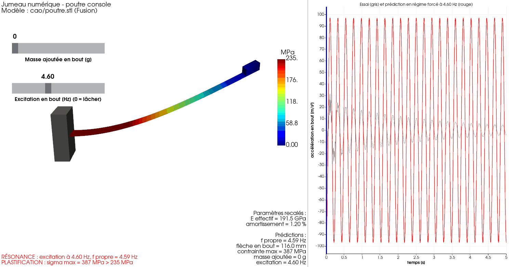
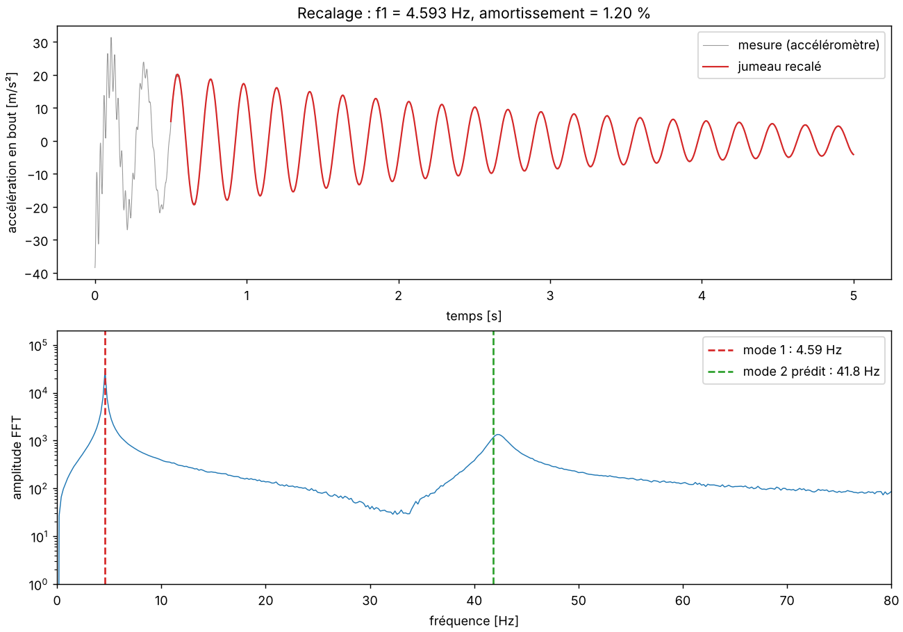
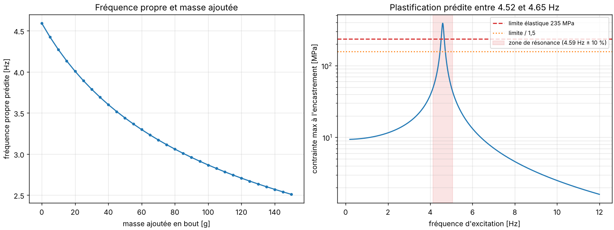

# 01 — Poutre console en acier

**Statut** : terminé (données d'essai synthétiques)



## Objectif

Construire le jumeau numérique d'une lame d'acier encastrée portant une masse en bout :
retrouver ses paramètres réels à partir d'un essai de lâcher, puis prédire sa fréquence propre,
sa flèche et sa contrainte maximale dans de nouvelles conditions, et alerter en cas de
résonance ou de plastification.

## Système et modèle 3D

- Géométrie conçue dans **Autodesk Fusion** : `cao/poutre.f3d`, exportée en `cao/poutre.stl`
- Lame : 300 × 30 × 1 mm, acier S235 (E = 210 GPa nominal, limite élastique 235 MPa)
- Masse en bout : bloc d'acier 20 × 30 × 10 mm (47 g)

## Essai de référence

Lâcher depuis une flèche d'environ 30 mm. Accéléromètre en bout et jauge de déformation à 10 mm
de l'encastrement, échantillonnés à 1 kHz pendant 5 s : `donnees/essai_lacher.csv`.

Les données sont **synthétiques** (`code/generer_donnees.py`) : le « vrai » système a un
encastrement imparfait, un amortissement inconnu et 1,5 g de colle et de vis non modélisés ;
les capteurs ajoutent du bruit et un décalage de zéro.

## Modèle physique et recalage

- **Modèle** : éléments finis de poutre d'Euler-Bernoulli (éléments d'Hermite, 40 éléments),
  masse ponctuelle en bout — extension du code du TP de méthode des éléments finis (`code/fe_poutre.py`).
  Vérification : mode 1 à 0,1 % de la formule de Rayleigh.
- **Recalage** (`code/recalage.py`) : FFT, puis moindres carrés sur un oscillateur amorti, puis
  module d'Young effectif tel que le modèle EF donne la fréquence mesurée.

| Grandeur | Nominal | Recalé |
| --- | --- | --- |
| Fréquence propre | 4,81 Hz | **4,59 Hz** |
| Module d'Young effectif | 210 GPa | **191,5 GPa** |
| Amortissement | inconnu | **1,20 %** |

Écart au système réel caché : 2,3 % sur E (il absorbe la masse de colle non modélisée), 0,1 % sur l'amortissement.



## Simulation visuelle

`python code/jumeau.py` ouvre une fenêtre interactive :
- la lame Fusion vibre en 3D (ralenti × 4), colorée selon la contrainte de flexion ;
- l'accélération mesurée et celle du jumeau défilent avec un curseur de temps ;
- un curseur ajoute une masse en bout, un autre impose une excitation sinusoïdale (0,15 N) en bout ;
- les prédictions et les alertes se mettent à jour en direct.

## Prédictions



- Fréquence propre : 4,59 Hz sans masse ajoutée, 2,87 Hz avec 100 g (`code/predictions.py`).
- Lâcher de 29 mm : contrainte maximale de 95 MPa à l'encastrement, sans risque.
- Excitation de 0,15 N : plastification prédite entre **4,52 et 4,65 Hz**.

## Cas critiques surveillés

- **Résonance** : excitation à moins de 10 % de la fréquence propre.
- **Marge insuffisante** : contrainte max > 157 MPa (limite élastique / 1,5).
- **Plastification** : contrainte max > 235 MPa.

## Limites

- Petits déplacements et matériau élastique linéaire : au-delà de la plastification, les valeurs
  affichées servent d'alerte, pas de prédiction exacte.
- Seul le premier mode est animé ; le second (≈ 42 Hz) est seulement prédit.
- Données synthétiques : à remplacer par un essai réel (smartphone + phyphox) pour valider le jumeau.

## Lancer

```
python code/generer_donnees.py      # (re)crée le jeu de données d'essai
python code/recalage.py             # recale le jumeau
python code/predictions.py          # figure de prédictions
python code/jumeau.py               # simulation 3D interactive
python code/jumeau.py --capture --excitation 4.6 --nom jumeau_resonance   # export GIF
```
